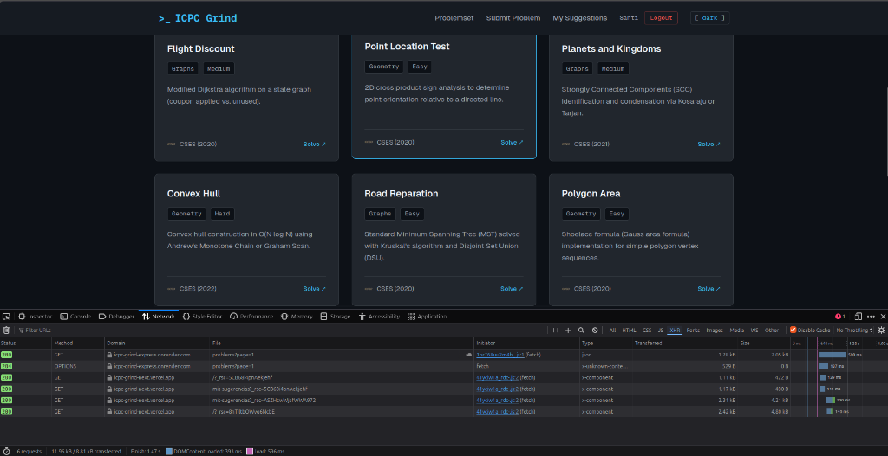

# ICPC Grind — Frontend Web App — Entrega 3

Evolución full-stack de la plataforma de entrenamiento para programación competitiva desarrollada en la Entrega 1. El proyecto conserva la identidad visual inspirada en terminales de desarrollo y GitHub con soporte para modo oscuro y claro, reconstruido sobre una arquitectura moderna basada en Next.js 16 con App Router, TypeScript estricto y Tailwind CSS v4.

* **Deploy en producción del Frontend:** [https://icpc-grind-next.vercel.app](https://icpc-grind-next.vercel.app)
* **Backend API en producción en Render:** [https://icpc-grind-express.onrender.com](https://icpc-grind-express.onrender.com)
* **Repositorio del Backend:** [https://github.com/sanma613/icpc-grind-express](https://github.com/sanma613/icpc-grind-express)

---

### Descripción del proyecto

En la Entrega 1 construí el frontend estático de ICPC Grind con HTML, CSS y TypeScript para centralizar problemas algorítmicos de plataformas como CSES, Codeforces y AtCoder. En esta Entrega 3 di el salto a una aplicación full-stack real: el catálogo ya no es un arreglo en memoria, sino que se consulta de forma paginada y filtrada desde una base de datos PostgreSQL mediante una API REST en Express; el formulario de sugerencias ya no simula agregados locales, sino que persiste las propuestas en la base de datos vinculadas al usuario autenticado; y el acceso al sitio cuenta con un sistema completo de autenticación y autorización basado en JSON Web Tokens con separación clara de roles entre competidores y administradores.

---

### Arquitectura del sistema y organización por features

Para mantener el código mantenible y desacoplado, estructuré el proyecto siguiendo el patrón de diseño por características propuesto en clase, aislando el enrutamiento dentro de `app/` y organizando la lógica de negocio bajo `src/features/`:

```
src/
├── app/                           # Rutas exclusivas del App Router para componer vistas
│   ├── layout.tsx                 # Envoltorio global con soporte de tema claro y oscuro
│   ├── page.tsx                   # Catálogo público con filtros y paginación sincronizada en URL
│   ├── login/page.tsx             # Formulario de inicio de sesión
│   ├── registro/page.tsx          # Formulario de registro de competidores
│   ├── mis-sugerencias/page.tsx   # Panel personal del usuario como ruta protegida
│   ├── admin/page.tsx             # Panel de gestión y moderación exclusivo para admin
│   └── not-found.tsx              # Página 404 personalizada con estética de consola
├── features/
│   ├── common/                    # Recursos transversales y utilidades base
│   │   ├── components/            # Button, Input, Pagination, StatusMessage, ConfirmDialog
│   │   ├── services/              # Cliente centralizado http.ts y mockServer.ts
│   │   └── config.ts              # Configuración de variables de entorno y API host
│   ├── auth/                      # Dominio de autenticación y control de sesión
│   │   ├── domain/                # Tipos de AuthUser, LoginDTO, RegisterDTO
│   │   ├── services/              # auth.service.ts y session.service.ts
│   │   ├── hooks/                 # Hook useAuth para estado global del usuario, login y logout
│   │   └── components/            # LoginForm y RegisterForm
│   ├── problems/                  # Catálogo de problemas algorítmicos
│   │   ├── domain/                # Entidades Problem, ProblemFilter, PaginationMeta
│   │   ├── services/              # problem.service.ts
│   │   ├── hooks/                 # Hooks useProblems y useAdminProblems
│   │   └── components/            # ProblemCatalog, ProblemFiltersBar, AdminProblemsTable, AdminProblemModal
│   └── suggestions/               # Interacción comunitaria para propuesta de problemas
│       ├── domain/                # Suggestion, SuggestionStatus, CreateSuggestionDTO
│       ├── services/              # suggestion.service.ts
│       ├── hooks/                 # Hooks useMySuggestions, useCreateSuggestion, useAdminSuggestions
│       └── components/            # SuggestProblemForm, MySuggestionsList, AdminSuggestionsTable
└── proxy.ts                       # Interceptor de servidor en Next.js 16 para protección SSR
```

**Regla de consumo de API:** Ningún componente visual ejecuta `fetch` directamente. La comunicación fluye estrictamente a través de la capa de servicios, expuesta a las vistas mediante hooks personalizados como `useProblems`, `useAuth` o `useCreateSuggestion`.

---

### Decisiones técnicas

#### 1. Flujo completo de autenticación y login
1. El competidor ingresa su correo y contraseña en `LoginForm` y envía el formulario.
2. El formulario realiza una validación previa en el cliente; si es correcta, invoca el método login de `authService`.
3. El servicio realiza una petición `POST /api/auth/login` hacia la API en Express.
4. En el backend, el caso de uso verifica la existencia del usuario y compara la contraseña contra el hash de PostgreSQL utilizando `bcrypt.compare`.
5. Al verificar las credenciales, el backend emite un JWT firmado con `JWT_SECRET` y vigencia de 7 días, cuyo payload contiene únicamente el identificador de usuario, correo y rol.
6. El frontend recibe la respuesta HTTP 200. En `session.service.ts` guardo el token en `localStorage` para que el cliente HTTP lo agregue a las peticiones del navegador y simultáneamente en la cookie de sesión `icpc_token` con SameSite Lax y ruta raíz.
7. El hook `useAuth` actualiza el estado reactivo de la aplicación y redirige al competidor a `/mis-sugerencias` o al catálogo.
8. Cuando el usuario navega a una ruta privada como `/admin`, el servidor de Next.js mediante `proxy.ts` intercepta la solicitud antes del renderizado, inspecciona la cookie y valida que el rol sea administrador. Si no cumple los requisitos, redirige de inmediato sin parpadeos de contenido. En paralelo, cada consulta posterior a la API viaja con el encabezado `Authorization: Bearer <token>`.

#### 2. Almacenamiento del token en el frontend y análisis de riesgos
* **Dónde se almacena:** Implementé un esquema híbrido guardando el token en `localStorage` y en cookies legibles por el cliente como `icpc_token` e `icpc_role`.
* **Riesgo:** El principal vector de ataque ante esta decisión es el Cross-Site Scripting o XSS. Si un atacante lograra inyectar código JavaScript malicioso en el sitio, podría acceder a `localStorage` y sustraer la sesión del usuario.
* **Justificación técnica y mitigación:** La alternativa estricta consiste en usar cookies con bandera HttpOnly emitidas exclusivamente por el backend. Sin embargo, para esta entrega decidí utilizar este esquema porque:
  1. Permite inyectar explícitamente el encabezado `Authorization: Bearer <token>` en el cliente HTTP, tal como lo exige la rúbrica y se evidencia en la pestaña Network.
  2. Permite que el interceptor de servidor de Next.js `proxy.ts` valide el token durante el Server-Side Rendering sin requerir llamadas síncronas bloqueantes al backend en cada petición.
  3. El riesgo de XSS se mitiga gracias a la arquitectura de React, que escapa automáticamente los valores en el JSX, y al tipado estricto con validaciones rigurosas que impiden inyecciones en el DOM.

#### 3. Diferencia entre HTTP 401 y 403 con ejemplos reales del proyecto
* **401 Unauthorized:** Ocurre cuando la petición carece de credenciales o el token presentado no es válido o ya caducó. Representa una falta o invalidez de autenticación.
  * *Ejemplo real 1:* Un usuario no autenticado intenta enviar una propuesta a `POST /api/suggestions` o consultar `GET /api/suggestions/mias` sin enviar la cabecera Authorization. El backend rechaza la petición indicando que el token no fue proporcionado o su formato es inválido.
  * *Ejemplo real 2:* Un usuario intenta iniciar sesión en `/login` con una contraseña errónea; el servidor responde 401 Credenciales inválidas de forma genérica para no revelar si falló el correo o la clave.
* **403 Forbidden:** Ocurre cuando el usuario está debidamente identificado mediante un JWT válido, pero su rol no cuenta con los privilegios suficientes para la acción solicitada. Representa una falta de permisos sobre el recurso.
  * *Ejemplo real:* Un competidor autenticado con rol `user` intenta invocar `DELETE /api/problems/:id` o `POST /api/problems`. El backend verifica que el token es legítimo y pertenece al usuario, pero el middleware `requireRole` detiene la ejecución y devuelve 403 No tienes permisos para realizar esta acción.

#### 4. Uso de Inteligencia Artificial y correcciones realizadas
* **Para qué se usó:** Todo el diseño del sistema, la separación de responsabilidades y la lógica fueron concebidos por mí. Me apoyé en herramientas de IA como asistente de pair-programming para acelerar el andamiaje inicial de componentes en Tailwind CSS v4, estructurar interfaces de TypeScript y asistir en la redacción técnica de este documento.
* **Qué tuve que corregir manualmente:**
  * *Filtros de catálogo y normalización de parámetros:* Inicialmente el backend fallaba con código 400 cuando el frontend enviaba filtros con valor all. Tuve que corregir la lógica en `problem.service.ts` para depurar los parámetros antes de enviarlos y asegurar que la paginación sincronizara limpiamente con el parámetro page en la URL.
  * *Ciclo de vida y coherencia en moderación:* La IA generaba botones de Reject en sugerencias que ya habían sido aprobadas. Rediseñé la vista de moderación para que por defecto muestre la cola de pendientes y, al ser aprobada, la sugerencia pase a alimentar el catálogo y se retire de la bandeja de acción inmediata.
  * *Adaptación a Next.js 16:* Tuve que migrar la protección de rutas del antiguo `middleware.ts` al nuevo estándar `proxy.ts`, resolviendo la decodificación de cookies y previniendo saltos de pantalla en rutas protegidas.
  * *Eliminación de emojis:* Removí todos los emojis generados en componentes, scripts y documentación para asegurar un estándar visual riguroso, limpio y profesional.

---

### Rutas especificadas en la rúbrica

| Ruta | Nivel de Acceso | Comportamiento |
|---|---|---|
| `/` | Público | Catálogo interactivo de problemas con búsqueda en vivo, filtros y paginación sincronizada en la URL con el parámetro page. |
| `/login` | Público con redirección | Formulario con validación en línea. Si ya existe sesión activa, redirige automáticamente al catálogo. |
| `/registro` | Público con redirección | Registro de competidores. Redirige al inicio si el usuario ya está autenticado. |
| `/mis-sugerencias` | Privado para user o admin | Listado histórico de los problemas propuestos por el usuario en sesión. Sin sesión redirige a `/login`. |
| `/admin` | Privado para admin | Panel de control con CRUD completo de problemas y moderación de propuestas comunitarias. Un usuario común es redirigido. |
| `not-found.tsx` | Público | Vista terminal 404 personalizada con opciones de retorno seguro. |

---

### Componentes comunes reutilizables

Desarrollados bajo `src/features/common/components/` para evitar código duplicado:
* **`Button`:** Soporta variantes primary, secondary, outline y danger, tamaños sm, md y lg, estado de carga isLoading y accesibilidad por teclado.
* **`Input`:** Control de formulario con manejo adyacente de errores en el prop error, etiqueta vinculada por ID y opción monoespaciada para enlaces y nombres de ejercicios.
* **`Pagination`:** Paginación accesible con indicador descriptivo de rango, botones de desplazamiento y cálculo automático de páginas.
* **`StatusMessage`:** Componente para estados de carga, vacío y error con botón de reintento mediante onRetry.
* **`ConfirmDialog`:** Modal accesible para operaciones destructivas utilizado antes de eliminar problemas del catálogo, sumando 1 punto de bonificación.

---

### Retos técnicos durante el desarrollo

1. **Protección de rutas en Next.js 16 con `proxy.ts`:**
   En Next.js 16 la convención de middleware cambió. El reto consistió en estructurar un interceptor en el servidor que decodificara el token empaquetado en la cookie sin sobrecargar el bundle de Edge runtime, permitiendo evaluar tanto la presencia del JWT como el rol del usuario antes de servir la página.
2. **Sincronización bidireccional entre la URL y el catálogo:**
   Para cumplir la rúbrica de mantener la paginación y filtros en la URL con el parámetro page, debí coordinar `useSearchParams` y `useRouter` de Next.js para que los cambios en los filtros reiniciaran la paginación a la página 1 sin generar bucles infinitos de renderizado.
3. **Separación de flujos de usuario frente al administrador:**
   Un usuario normal requiere sugerir problemas a través del formulario submit y revisar el veredicto en mis sugerencias. Para un administrador este flujo resultaba redundante porque no tiene sentido auto-sugerirse un ejercicio para luego auto-aprobárselo. Resolví esto adaptando la barra de navegación y la Home para que el administrador acceda directamente al panel donde puede publicar ejercicios de forma inmediata en el catálogo.

---

### Credenciales de prueba

Generadas a través del seed oficial de la base de datos:

| Rol | Correo Electrónico | Contraseña | Permisos |
|---|---|---|---|
| **Administrador** | `admin@icpc.org` | `Admin123*` | Acceso a `/admin`, CRUD de problemas, moderación de sugerencias |
| **Competidor** | `user@icpc.org` | `User123*` | Acceso a `/mis-sugerencias`, envío de propuestas en formulario |

---

### Instrucciones de ejecución local

1. Clonar el repositorio e instalar dependencias:
   ```bash
   git clone https://github.com/sanma613/icpc-grind-next.git
   cd icpc-grind-next
   npm install
   ```

2. Configurar variables de entorno:
   ```bash
   cp .env.example .env.local
   ```
   Asegurar que `.env.local` contenga:
   ```env
   NEXT_PUBLIC_API_HOST="http://localhost:4000"
   NEXT_PUBLIC_USE_MOCKS=false
   ```
   Si deseas probar el frontend de forma desacoplada sin levantar el backend, puedes fijar NEXT_PUBLIC_USE_MOCKS en true.

3. Iniciar el servidor de desarrollo:
   ```bash
   npm run dev
   ```
   Abrir `http://localhost:3000` en el navegador.

4. Validar compilación y tipos:
   ```bash
   npx tsc --noEmit
   npm run lint
   npm run build
   ```

---

### Evidencia de integración de red en la pestaña Network

Peticiones HTTP con estado 200 OK hacia la API en Render con el catálogo de problemas y comunicación activa entre Vercel y Render:


